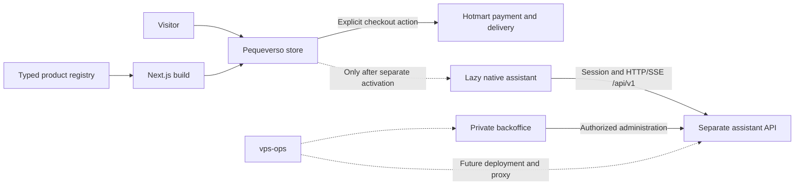
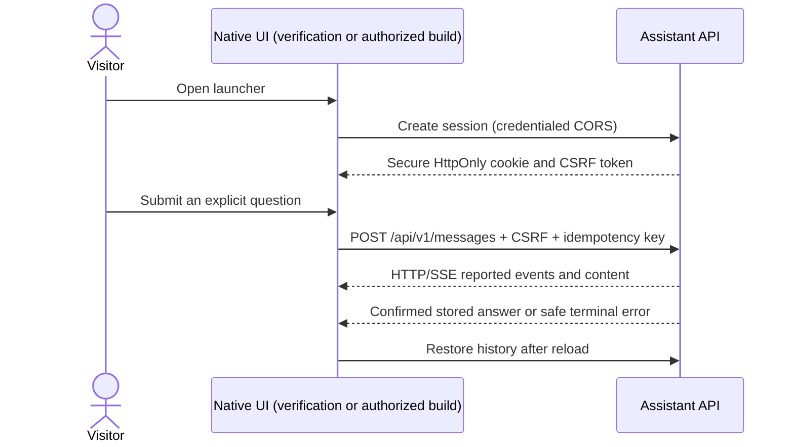
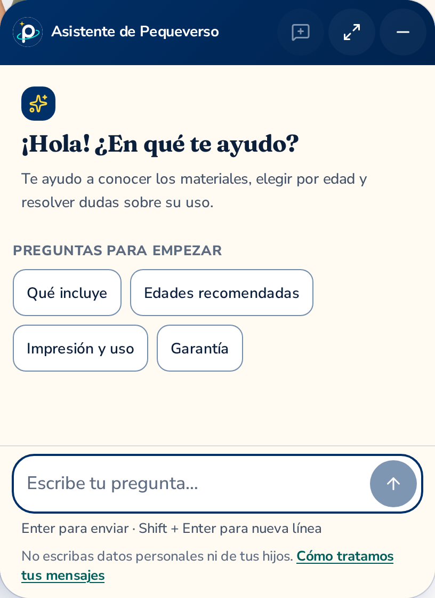
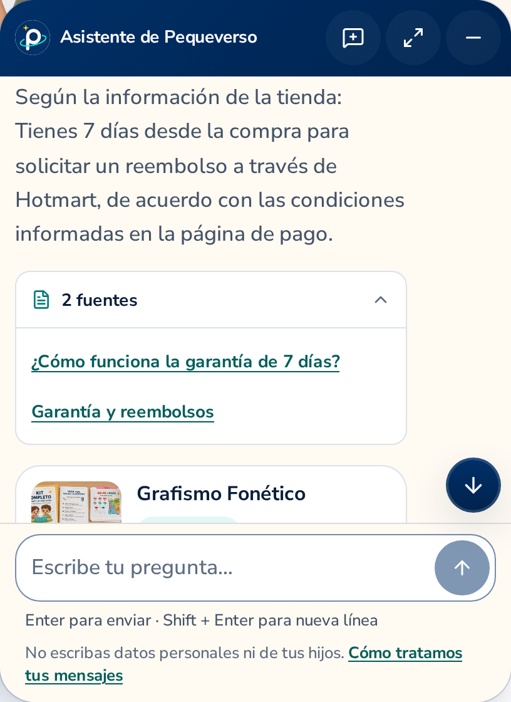

# Pequeverso

Printable learning resources and curated courses for families: Grafismo Fonético for ages 3–7 and the third-party Guía de Alimentación para Bebés for 6–12 months. This repository contains the public store and its native shopping assistant; Hotmart handles payments, delivery and refunds.

[](https://github.com/gonzalomartinperez/pequeverso/actions/workflows/ci.yml)
[](https://github.com/gonzalomartinperez/pequeverso/actions/workflows/nightly.yml)
[](https://github.com/nodejs/Release#release-schedule)
[](package.json)
[](package.json)
[](tsconfig.json)
[](docs/design-system.md)
[](docs/assistant.md)

> **The assistant remains disabled in publishable builds.** No launcher, runtime or API traffic is emitted without explicit activation and a rebuild. Fixture previews demonstrate local behavior; they do not establish production readiness.
>
> Source code is MIT. Pequeverso brand, copy and media are all rights reserved: [LICENSE](LICENSE), [LICENSE-CONTENT.md](LICENSE-CONTENT.md).

## Architecture at a glance



The store presents **Grafismo Fonético** and the affiliate **Guía de Alimentación para Bebés**, with their respective format, audience and ownership clearly identified. The optional **Pack Imprime y Juega** remains a post-purchase offer. Product facts come from the [typed registry](src/products), [affiliate registry](config/affiliates.ts) and [commerce configuration](config/commerce.ts); copy never invents prices, guarantees or benefits. Offer pages embed the Hotmart sales-funnel widget; a thank-you URL is not proof of payment and exposes no product files.

Dependency direction, client/server separation, acyclic runtime imports and negative architecture
fixtures are enforced by the required CI build. See [engineering standards](docs/engineering-standards.md)
and run `npm run check:architecture` locally.

| Application | Responsibility | Operational boundary |
|---|---|---|
| This store | Public product pages, checkout links, native conversation UI | Static export by default; Node standalone also supported |
| [Assistant API](https://github.com/gonzalomartinperez/pequeverso-assistant-api) | Sessions, grounding, streaming, conversation persistence and provider credentials | Deployment belongs to vps-ops; no provider secret reaches this store |
| [Backoffice](https://github.com/gonzalomartinperez/pequeverso-assistant-backoffice) | Private administration and authenticated operations | Separate application; never a public chat iframe |
| vps-ops | VPS deployment, Coolify, reverse proxy and shared infrastructure | This repository supplies artifacts and contracts; it does not provision the VPS |

Hosting was last confirmed **unconnected on 2026-10-10**, with `main` selected for the future Hostinger connection. A source merge alone is not deployment evidence. [Build targets, routing and boundaries](docs/architecture.md) · [Hosting and deployment gates](docs/deployment.md).

## Native assistant

A star-only launcher opens a compact conversation panel on desktop and a comfortable viewport-aware surface on mobile. The assistant uses Pequeverso navy, cream, gold and teal; there is no independent dark/light theme. The interface is Spanish-only, with no language selector. It preserves history and drafts when minimized, resized or restored.



Messages are rendered safely as text and supported formatting, with validated links, sources and product fields. The UI does not invent stages, tools, percentages, transactions or feedback endpoints. Interrupted or failed generations require an explicit visitor action; no automatic generation retry is added. Provider keys belong only to the backend.

| Build | Output | May be published? |
|---|---|---|
| Default: flag unset/false | Assistant compiled out; `build-info.json` says `disabled` | After normal release/deployment gates |
| Isolated local fixture build | `out-assistant-fixture/`, explicitly marked unpublishable | **Never** |
| Future enabled build | Requires reviewed API origin, owner authorization and verified VPS backend | Not authorized by this implementation |

[Behavior, contract and activation checklist](docs/assistant.md) · [Reproducible evidence and limitations](docs/verification/assistant.md).

### See the actual interface

These are high-resolution photographs of the **local fixture build**, at the default compact
size. They show the real welcome, answer/source disclosure and complete product details; they
are not screenshots of an activated production assistant.

| Compact desktop welcome | Answer with its sources | Complete product card on mobile |
|---|---|---|
| <a href="docs/verification/assistant/2026-10-12/desktop-bienvenida-detalle.png"></a> | <a href="docs/verification/assistant/2026-10-12/desktop-respuesta-fuentes-detalle.png"></a> | <a href="docs/verification/assistant/2026-10-12/mobile-producto-precio-acciones-detalle.png"></a> |

[Open the detailed gallery](docs/verification/assistant/2026-10-12/README.md) for original PNGs,
full-window context, waiting, streaming, retained drafts and safe network-error states. Each photo
has source/API provenance and a SHA-256 in its [manifest](docs/verification/assistant/2026-10-12/manifest.json).


## Clean checkout

```bash
nvm use                         # Node 24 from .nvmrc
npm ci                          # Exact lockfile; lifecycle scripts disabled
cp .env.example .env.local       # Local sample configuration; assistant remains disabled
npm run dev                     # Local development
```

The site origin and checkout URL are required build-time configuration. The example checkout is a test value, not a production offer. Optional integrations have documented no-op behavior when their variables are empty; review [.env.example](.env.example) before using any real deployment values. No OpenAI key is required for the store or fixture suite.

```bash
npm run check                   # Lint, strict types, unit, export and budgets
npm run check:skills             # Canonical skill/adaptor consistency
npm run check:assistant-disabled # Inspect the actual publishable export
npx playwright install --with-deps chromium firefox webkit
npm run test:e2e                 # Storefront browser gates against the built export
```

For assistant verification, use an **isolated API checkout** at the exact SHA in [tests/assistant/api-revision](tests/assistant/api-revision), run `uv sync --frozen` there, then:

```bash
ASSISTANT_API_DIR=/path/to/isolated-api-checkout npm run test:e2e:assistant
```

This command builds the assistant separately and runs the real session/CSRF/HTTP/SSE flow with the fixture provider. It uses throwaway self-signed HTTPS loopback and an isolated database, never a provider key. Do not publish its output. [Full development commands](docs/development.md).

## Design and verification

- Next.js 16 App Router and React 19: Server Components by default, small client islands.
- Strict TypeScript, Tailwind 4, owned shadcn/Base UI primitives and CSS Modules for custom geometry.
- Self-hosted OFL Fraunces/Nunito Sans; shared design tokens and reduced motion.
- Node tests, Playwright across Chromium/Firefox/WebKit where applicable, axe and Lighthouse CI.
- Both static export and standalone parity are checked; budgets cover rendered output, media, bundle and scene behavior.
- Skills are reviewed procedures, never activation, payment or deployment authorization.

Measured runs and screenshots establish what was actually exercised. CI does not prove real Hotmart purchases, production cookie/proxy behavior, physical phone keyboards, field Core Web Vitals or real-model answer correctness. These remain separately recorded acceptance items.

## Repository map

| Path | Purpose |
|---|---|
| `src/app` | Public routes, legal/support pages, metadata and 404 |
| `src/products`, `config` | Product/commerce facts, budgets, assistant flag and edge rules |
| `src/components` | Owned UI primitives, server blocks and layout |
| `src/features/assistant` | Domain, controller, adapters and native presentation |
| `contracts/assistant-api` | Pinned API contract artifacts and provenance |
| `src/features/commerce`, `src/features/tracking` | Existing checkout and consent-gated events |
| `src/motion` | CSS motion and lazily loaded scene with static fallback |
| `content/es` | Store and Spanish-only assistant copy |
| `media/manifest.json`, `tools/media` | Media provenance, rights and build-time pipeline |
| `scripts`, `tests`, `.github` | Build/publish guards, verification and protected workflow |
| `.agents/skills`, `.claude/skills` | Canonical skills and checked thin adapters |

## Documentation and contribution

Start with [AGENTS.md](AGENTS.md) and [CONTRIBUTING.md](CONTRIBUTING.md). Task branches originate from `develop`; task PRs squash into `develop`. An authorized `develop`→`main` release uses a merge commit with required checks and no protection bypass.

| Read | For |
|---|---|
| [Architecture](docs/architecture.md) | Data flow, build targets, routes and component boundaries |
| [Design system](docs/design-system.md) | Brand roles, typography, controls, accessibility and motion |
| [Assistant](docs/assistant.md) | Native runtime, compatible contract and activation conditions |
| [Development](docs/development.md) | Setup and verification commands |
| [Deployment](docs/deployment.md) | Hostinger modes, release artifacts and post-deploy evidence |
| [Content model](docs/content-model.md) | Approved business facts and registry rules |
| [Tracking](docs/tracking.md) | Consent and existing event ownership |
| [Media](docs/media.md) | Provenance, rights and asset budgets |
| [Decisions](docs/decisions) | Recorded architectural choices |
