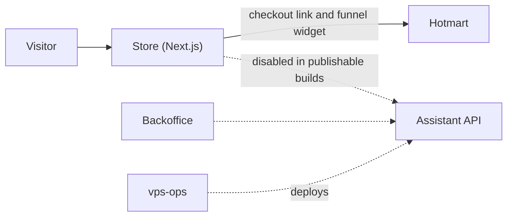

<!-- Variant: PUBLIC -->
<div align="center">
  
  <h1>Pequeverso</h1>
  <p>Printable learning kits and curated courses for families, with a fast, honest Hotmart checkout.</p>
  <a href="https://github.com/gonzalomartinperez/pequeverso/actions/workflows/ci.yml"></a>
  <a href="https://github.com/gonzalomartinperez/pequeverso/releases"></a>
  <a href="LICENSE"></a>
</div>

## Why

A parent on a phone needs to understand, trust and buy in about a minute. This repository is the
public store of Pequeverso: the printable kit Grafismo Fonético (ages 3-7) and the recommended
third-party Guía de Alimentación para Bebés (6-12 months). Hotmart owns payment, delivery and
refunds; the site owns the explanation. Business facts live in typed configuration, never in copy.

## Highlights

- Next.js 16 App Router and React 19: Server Components by default, small client islands.
- Production is the Hostinger Node.js Web App building `main` as a standalone server
  ([ADR-0010](docs/decisions/ADR-0010-standalone-production-target.md)); the static export is a
  parity build until it is retired.
- Strict TypeScript 7, Tailwind 4 with owned shadcn/Base UI primitives, one light theme
  ([ADR-0006](docs/decisions/ADR-0006-shadcn-tailwind-design-system.md)).
- Accessibility (WCAG 2.2 AA), CLS and LCP budgets are acceptance criteria, checked by Playwright,
  axe and Lighthouse CI.
- Consent-gated tracking; the site never emits `InitiateCheckout` or `Purchase`.

## Architecture



Dependencies point inward: `src/app` and `src/views` compose `src/features` and `src/shared`;
business facts come from `config/` and reviewed copy from `content/`. Both are enforced by
`npm run test:architecture`. See [docs/architecture.md](docs/architecture.md) and the
[generated diagrams](docs/architecture/README.md).

## Quickstart

```bash
nvm use && npm ci                # Node 24 from .nvmrc; exact lockfile
cp .env.example .env.local       # sample configuration; assistant stays disabled
npm run check                    # local lint, types, unit, build and budget checks
npm run dev                      # local development
```

The browser and performance gates run in CI only; see the [CI profile](docs/reference/ci-profile.md). Requirements: Node 24 LTS (`.nvmrc`). The site origin and checkout URL are required build-time
variables; see [.env.example](.env.example) and [docs/development.md](docs/development.md).

## Usage

- Browser gates: `npm run test:browser` after `npx playwright install --with-deps chromium`.
- Production build: `NEXT_OUTPUT=standalone` (ADR-0010); verify the deployed SHA at `/build-info.json`.
- Change copy, prices or products: [content model](docs/content-model.md) and `config/`.
- Release and verification: [deployment](docs/deployment.md). Live site: https://pequeverso.com/

## Quality

| Gate | Tool | Threshold |
|---|---|---|
| Lint and format | Biome | zero warnings |
| Types | TypeScript 7 strict | no errors |
| Unit and property tests | `node:test` | all pass |
| Dead code | knip | clean |
| Browser, a11y | Playwright, axe | WCAG 2.2 AA, no violations |
| Performance | Lighthouse CI, budgets | LCP at most 2.5 s, CLS at most 0.1 |

Ratchets in [`ratchets/`](ratchets) only tighten; the scorecard is described in
[docs/master-plan/scorecard.md](docs/master-plan/scorecard.md). Results are on the
[CI runs](https://github.com/gonzalomartinperez/pequeverso/actions/workflows/ci.yml).

## Documentation

| Kind | Start with |
|---|---|
| Tutorials | [Development](docs/development.md) |
| How-to | [Deployment](docs/deployment.md), [Media](docs/how-to/update-media.md), [Hotmart funnel](docs/hotmart-funnel.md) |
| Reference | [Architecture](docs/architecture.md), [Design system](docs/design-system.md), [Content model](docs/content-model.md), [Tracking](docs/tracking.md) |
| Explanation | [Decisions (ADRs)](docs/decisions/README.md), [Assistant](docs/assistant.md) |
| Master plan | [docs/master-plan](docs/master-plan/README.md) |

Agents start with [AGENTS.md](AGENTS.md).

## Ecosystem

| Repository | Role | Link |
|---|---|---|
| portfolio | Public portfolio site | [gonzalomartinperez/portfolio](https://github.com/gonzalomartinperez/portfolio) |
| portfolio-assistant-api | Portfolio assistant API | [gonzalomartinperez/portfolio-assistant-api](https://github.com/gonzalomartinperez/portfolio-assistant-api) |
| portfolio-backoffice | Portfolio backoffice | [gonzalomartinperez/portfolio-backoffice](https://github.com/gonzalomartinperez/portfolio-backoffice) |
| pequeverso | Public store site (this repository) | [gonzalomartinperez/pequeverso](https://github.com/gonzalomartinperez/pequeverso) |
| pequeverso-assistant-api | Store assistant API | [gonzalomartinperez/pequeverso-assistant-api](https://github.com/gonzalomartinperez/pequeverso-assistant-api) |
| pequeverso-backoffice | Store backoffice | [gonzalomartinperez/pequeverso-backoffice](https://github.com/gonzalomartinperez/pequeverso-backoffice) |
| vps-ops | VPS operations (private) | (private) |

## Contributing and security

[CONTRIBUTING.md](CONTRIBUTING.md) · [SECURITY.md](SECURITY.md) · [CODE_OF_CONDUCT.md](CODE_OF_CONDUCT.md) ·
[SUPPORT.md](SUPPORT.md). Task branches go to `develop` by squash PR; releases are a merge-commit
PR `develop` to `main`.

## Scope and limits

- The native shopping assistant is disabled in every publishable build; see
  [docs/assistant.md](docs/assistant.md) before changing it.
- Hotmart owns payment, delivery and refunds; a thank-you URL is not proof of payment.
- CI does not prove real purchases, field Core Web Vitals or production cookie behavior.

## License

Source code is MIT ([LICENSE](LICENSE)); brand, copy and media are all rights reserved ([LICENSE-CONTENT.md](LICENSE-CONTENT.md)).
