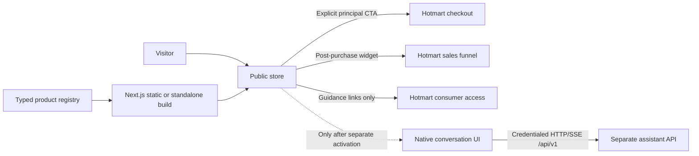
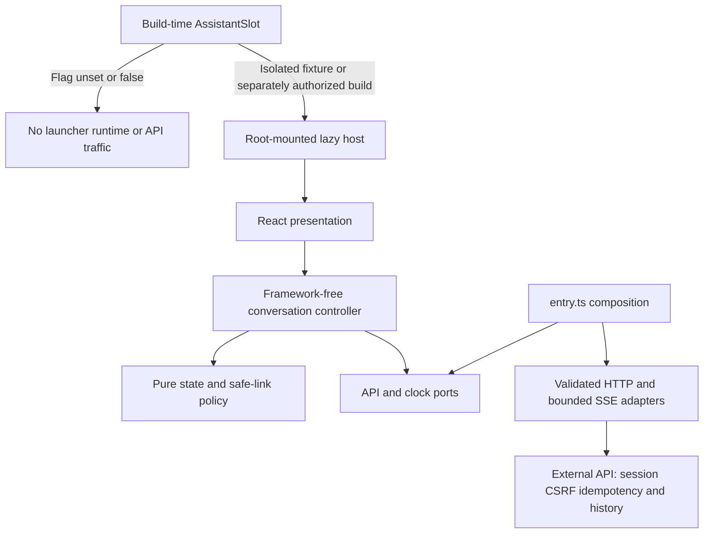

# Architecture

## Shape

pequeverso.com is a small commercial site: a homepage (hub), the principal product landing, an
optional post-purchase offer page with a query-driven downsell mode, a thank-you page, legal and
support pages, and a real 404. There is no database, CMS or authentication: payments, delivery
and refunds run on Hotmart. The only server endpoint is the Meta Conversions API relay
(`POST /api/meta/events/`): core in `server/meta-capi.ts`, served by `scripts/serve-static.ts`
(export) and by a standalone-only route handler (Node target).




## Build targets

| | Static export (default) | Node standalone (fallback) |
|---|---|---|
| Config | `NEXT_OUTPUT=export` (default) | `NEXT_OUTPUT=standalone` |
| Serving | Hostinger website (LiteSpeed) serving `public_html`, pulled from the `deploy` branch by Hostinger Git | Hostinger Node.js Web App building `release`/`main` (forces `standalone`; auto-detected by `/hbuilds/`) |
| Redirects/headers | `out/.htaccess` generated from `config/edge-rules.json` | `redirects()`/`headers()` from the same file |
| Meta CAPI relay | `scripts/serve-static.ts` mounts `server/meta-capi.ts` (Node.js Web App only; the LiteSpeed mode has no relay) | `src/app/api/meta/events/route.standalone.ts`, compiled only when `output === "standalone"` (`pageExtensions` adds `standalone.ts`) |
| Images | Build-time WebP derivatives (`tools/media`), `images.unoptimized` | same |
| Status | Supported (Deploy workflow publishes `deploy`) | **Connected to `main` since 2026-10-13** (owner confirmed); Hostinger automatically builds and publishes merges. Post-deploy verification is enabled. On 2026-10-17 the owner confirmed the product page works in a browser; an earlier HEAD probe returned HTTP 403 and remains a probe-specific observation, not a diagnosed hosting outage. Each release still requires its own post-deploy verification |

Rules that keep both targets valid: no `proxy.ts`/middleware, no `cookies()`/`headers()`/request-time
APIs, no route handlers beyond `sitemap.ts`/`robots.ts`/metadata images (plus `*.standalone.ts`
handlers, invisible to the export), no runtime image optimizer. Server logic lives in `server/`
(transport-agnostic cores with a Node adapter); standalone route handlers are thin wrappers. ADRs: `docs/decisions/ADR-0001-hosting-target.md`, `ADR-0005-conversions-api-relay.md`.

## Source tree

```
config/          site-wide facts: site.ts (brand, URLs), commerce.ts (currency, guarantee, passthrough
                 allowlist, Hotmart URLs), affiliates.ts (approved affiliate facts and redirect env key),
                 edge-rules.json, budgets.json
content/es/      neutral-Spanish copy: home.ts, hub.ts (shared need labels), gracias.ts, legal/,
                 products/<slug>/{copy,resources,faq}.ts
src/products/    the product registry (schema.ts, <slug>.ts modules, index.ts, jsonld.ts)
src/app/         routes: page.tsx (hub), [product]/ (one landing per registry product),
                 [product]/gracias/ (thank-you of core products), legal/support pages, sitemap, robots
src/features/    assistant/ (native shopping assistant, compiled out unless enabled), landing/ (CoreLanding,
                 OfferLanding, ThanksPage templates), home/ (two-product chapters and sticky chooser),
                 hub/ (shared product needs and menu), commerce/ (client islands), gallery/, tracking/
src/app/globals.css  design tokens, Tailwind v4 theme bridge, base layer, utilities (docs/design-system.md)
src/components/  ui/ (shadcn/ui primitives on Base UI + server-safe *-variants.ts), blocks/ (server
                 blocks: section, grid, split, price-block, cta-button, faq, …), layout/ (page-shell,
                 header + lazy mobile-nav sheet, footer, legal-layout)
src/motion/      motion.css, reveal/tilt/counter/flip/parallax/sticky components, page-motion (WAAPI),
                 scene/ (lazy three + gsap starfield, static SVG fallback, useSceneRuntime)
src/lib/         media.ts (manifest access), metadata.ts, utils.ts (`cn` on compiled tables), cx.ts
media/, public/  media manifest and build-time renditions (tools/media)
server/          meta-capi.ts (Conversions API relay core + Node adapter, erasable TypeScript run by Node); used by
                 scripts/serve-static.ts and src/app/api/meta/events/route.standalone.ts (alias @server/*)
```

## Product registry

`src/products` is the source of core kit and post-purchase-offer facts; the affiliate course
uses the separate configuration described below. Each registry product is a module
(`src/products/grafismo-fonetico.ts`, `src/products/imprime-y-juega.ts`) declared with
`satisfies ProductInput` and parsed once, at build time, by `src/products/index.ts` through the Zod
schema in `src/products/schema.ts` (discriminated union on `kind`):

| Field | `core` (principal product) | `post-purchase-offer` |
|---|---|---|
| identity | `slug` (route), `code` (media namespace), `name`, `shortName`, `checkoutTitle?` | same |
| `composition` | `pdfCount`, `pageCount`, `ageRange`, `visibleResources?` | same |
| `media` | `hero`, `og?`, `pageIds[]`, `videoIds[]`, `cards[]`, `scenes {problem, credibility}` | `hero`, `og?`, `pageIds[]`, `videoIds[]`, `cards[]` |
| `seo` | `index`, `title`, `description`, `priority` | same (`index: false`) |
| `resources`, `copy` | the real PDFs and the typed landing copy from `content/es/products/<slug>/` | same |
| `pricing` | `{ list }` | `{ upsell, downsell }` |
| `checkout` | `envKey`, `url` (static `process.env` reference), `offer`, `sckPrefix` (<= 6 chars) | — (never a direct checkout) |
| `funnel` / `parent` | `thanksPath`, `postPurchaseOffer?` | `parent` (a core slug), `decision: "hotmart-widget"` |

Every media id is refined with `hasMedia()` (unknown ids fail the build); the registry as a whole
checks unique slugs/codes, that `parent`/`postPurchaseOffer` resolve to the right kind, that
`thanksPath` is `/<slug>/gracias/` and that resource page counts sum to `composition.pageCount`.
API: `products`, `getProduct(slug)`, `coreProducts()`, `offerProducts()`, `indexableProducts()`,
`featuredProduct()` (the hub's own kit), `checkoutFallbackPath(product)`. Zod and the media manifest
stay on the server: client islands (`CheckoutLink`, `ProductInterestLink`, `OfferModeMirror`) receive
plain props from the templates. `src/products/jsonld.ts` emits a `Product` + single `Offer` (and a
`BreadcrumbList`) for indexable core products only — never ratings, reviews or merchant-listing fields.
ADR: `docs/decisions/ADR-0002-product-registry.md`.

## Home hub and affiliate course

`src/app/page.tsx` composes `src/features/home/`: equal product doors, the reading
chapter (`#leer`), first-meals chapter (`#bebe`), FAQ, closing choices and contextual
sticky chooser. `src/features/hub/hub-products.ts` projects the core kit registry
and `config/affiliates.ts` into the shared need model used by doors and menus.
Page copy lives in `content/es/home.ts`; shared labels live in `content/es/hub.ts`.
`HubProductLink` receives the plain shared need model (with a type-only import),
then selects exactly one existing `ProductInterestLink` or `AffiliateLink` handler.
The registry stays outside the client import graph; stable `#leer` / `#bebe` chapters
remain informational rather than an extra required selection step.
The full behavior and ownership map is the [Home hub spec](specs/home-hub.md).

`config/affiliates.ts` owns the approved course facts, local redirect path and
configuration key; the actual affiliate destination is a deployment value. The
`/alimentacion-bebe/` redirect is declared in `config/edge-rules.json` (temporary302;
404 when its destination variable is unset), with no local course landing. This
course is not a third `src/products` kind and does not inherit the kit's price,
PDF composition or funnel. Home links to the kit landing before its configured
checkout, while `AffiliateLink` sends an explicitly disclosed recommendation
through the configured redirect. Post-purchase offers retain their existing
Hotmart widget flow. See [affiliate configuration](affiliates.md) for the redirect
and attribution contract; those facts are not duplicated in presentation code.

## Routes

`src/app/[product]/page.tsx` (`dynamicParams = false`, `generateStaticParams` from the registry)
renders `CoreLanding` or `OfferLanding` by kind; `src/app/[product]/gracias/page.tsx` renders
`ThanksPage` for core products. Adding a product module therefore adds its routes, sitemap entry,
footer/404 links and terms paragraph without touching the app tree.

| Route | Role | robots | canonical |
|---|---|---|---|
| `/` | Two-product hub (`#leer` / `#bebe`) | index | self |
| `/alimentacion-bebe/` | Configured temporary affiliate redirect, separate from the registry | — (redirect or404) | — |
| `/grafismo-fonetico/` | Principal landing (checkout CTA), `[product]` core | index | self |
| `/imprime-y-juega/` | Upsell (Hotmart widget), `[product]` offer | noindex | self |
| `/imprime-y-juega/?downsell=1` (alias `?offer=downsell`) | Same page, downsell mode | noindex | `/imprime-y-juega/` |
| `/grafismo-fonetico/gracias/` | Post-purchase guidance, `[product]/gracias` | noindex | self |
| `/aviso-legal/`, `/privacidad/`, `/cookies/`, `/terminos/`, `/compras-y-reembolsos/` | Legal | noindex,follow | self |
| `/soporte/` | Support and contact | index | self |
| anything else | Real 404 (`out/404.html`, `ErrorDocument 404`) | — | — |

All routes are trailing-slash canonical (`trailingSlash: true`; the server redirects the non-slash
form). `www` → apex and `http` → `https` are handled in `.htaccess` in one hop.

## Offer mode (`?downsell=1`)

Both the upsell and the downsell views are rendered into the static HTML of `/imprime-y-juega/`.
A classic inline script — the first child of `<main id="contenido" data-offer-root suppressHydrationWarning>` —
reads `location.search` before the sibling views are parsed and sets `data-offer="downsell" |
"upsell"` on that element. Global CSS hides the inactive view (`.only-upsell` / `.only-downsell`),
so there is no flash, no layout shift and no redirect hop. After hydration a client island reads
`useSearchParams()` (inside `<Suspense>`) to mirror the mode for event parameters and `aria-hidden`.
Exactly one `#hotmart-sales-funnel` container exists on the page, outside both views. The Hotmart
widget itself is identical in both modes: Hotmart decides the offer from the buyer's funnel session.

## Native shopping assistant (disabled)

`src/features/assistant/` holds the store's only public conversation UI with
`pequeverso-assistant-api` (separate HTTPS origin, credentialed CORS; no endpoint or proxy in this
repository). `src/app/layout.tsx` renders `AssistantSlot`, which imports the client code only when
`NEXT_PUBLIC_ASSISTANT_ENABLED === "true"` at build time; the default build emits none of it
(`scripts/check-assistant-disabled.ts`). Layers: `domain` (pure) → `application` (controller, ports)
→ `adapters` (HTTP/SSE, validation) → `presentation` (React), wired only in `entry.ts`
(`tests/unit/assistant/boundaries.test.ts`). Details and activation: `docs/assistant.md`, ADR-0008.

### Assistant ownership and runtime



The store owns presentation, safe rendering, its compatible contract pin and publish guards.
The API owns provider credentials, grounding and conversation persistence; the private backoffice
owns authenticated administration. vps-ops owns future deployment, proxy and shared infrastructure.
The storefront contains no provider key, public assistant endpoint, database or backoffice login.

At standard text size, the desktop launcher opens a compact 408×560 px maximum region without a
scrim; expanding is an explicit choice. Mobile follows VisualViewport and safe areas. The single
mounted controller survives minimizing, client navigation and resizing. Its interface is Spanish-only,
with no language selector.
Question chips may abbreviate known labels, but accessible names and submitted questions stay
complete. Sources and product facts stay available in the scrollable transcript. The latest-answer
control lives in the panel header once messages exist; it does not overlay the transcript or reserve
a gutter that changes the width of earlier messages.

Default publishable artifacts must pass `check:assistant-disabled` and record
`"assistant": "disabled"` in `build-info.json`. Local fixture screenshots do not validate a real
provider, physical phone keyboard or production VPS cookies/CORS/proxy behavior. See
[assistant verification](verification/assistant.md) and [activation requirements](assistant.md).

## Commerce and tracking boundaries

- `src/products` holds prices, composition, checkout and funnel facts per product; `config/commerce.ts`
  keeps the shared ones (currency, guarantee, passthrough allowlist, Hotmart URLs).
  `features/commerce/checkout-url.ts` builds checkout URLs (never forwards `off`/`ref`) and the
  per-product `sck=pv-<sckPrefix>-<position>`.
- `features/tracking` owns site events (PageView, ViewContent, PequeversoProductInterest,
  PequeversoAffiliateClick, CheckoutIntent) with UUID event IDs, gated by `consent.ts`, sent by the browser pixel and
  mirrored through the same-origin Conversions API relay with the same ids. Hotmart owns
  InitiateCheckout and Purchase. See `docs/tracking.md`.

## Deployment and verification

`scripts/build-info.ts` writes `public/build-info.json` (`sha`, `ref`, `builtAt`) served with
`Cache-Control: no-store`; the deploy workflow compares it with the commit it built and runs
`scripts/smoke.ts` before declaring success. See `docs/deployment.md`.


### Enforced dependency contracts

[Engineering standards](engineering-standards.md) document ownership, review and blocking CI rules.
`npm run check:architecture` parses imports with Oxc, checks runtime cycles and follows client
imports transitively through barrels and aliases. Assistant presentation receives a stable
controller from `runtime.tsx`; only `entry.ts` constructs its HTTP adapter. Domain and application
receive platform IO through ports, including cancellation deadlines and waits. Presentation uses
application types only. Biome checks restricted globals semantically, including code after URL
strings; negative fixtures exercise the actual rules.

The exact `src/lib/cn-tables` module is a generated build artifact owned by `cn/next` in
`config/next.ts`. Its declaration is tracked and its JavaScript is generated before Next builds.
When present the checker parses its JavaScript; a clean checkout may omit it until generation.
The existing public `media/manifest.json` import is explicitly permitted; other asset imports
must exist under this repository’s `src/` or `content/`. Other unresolved local imports in client graphs fail closed. These checks supplement behavior,
strict typing and disabled-build verification; they do not prove production security.
