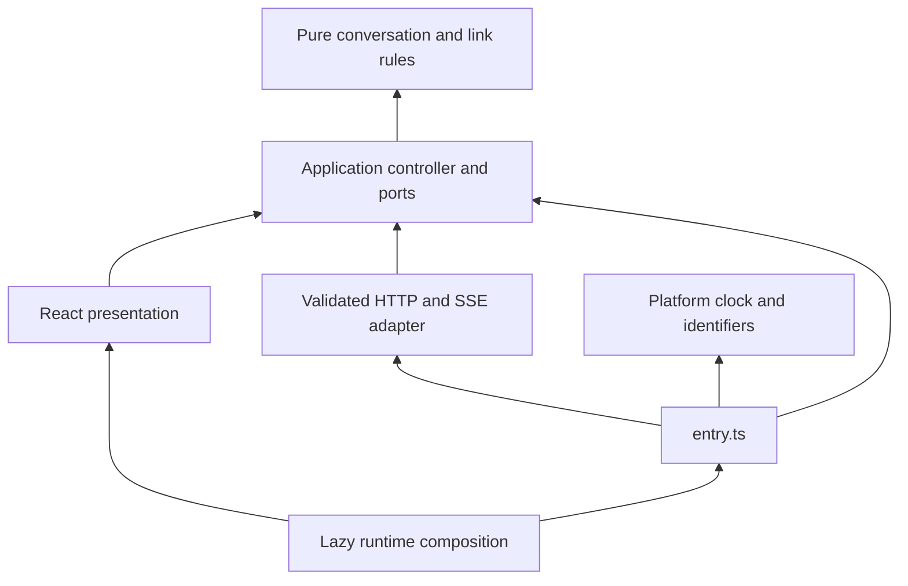

# Engineering standards

These standards preserve Pequeverso's commercial behavior while making changes testable and
reviewable. `AGENTS.md`, contract compatibility and the existing activation rules remain binding.

## Ownership across the four sessions

| Owner | Exclusive repositories | Coordination boundary |
|---|---|---|
| Portfolio public site | `portfolio` | Its visual identity, public site and build artifacts |
| Portfolio assistant | `portfolio-assistant-api`, `portfolio-assistant-backoffice` | Its own contracts, provider configuration and identity |
| Pequeverso | `pequeverso`, `pequeverso-assistant-api`, `pequeverso-assistant-backoffice` | Commercial facts, native UI, API and private administration |
| VPS operations | `vps-ops` | Coolify, proxy, deployment, shared resources and operational verification |

Each owner edits its own branches/worktrees and lockfiles. References to another implementation
use an identified commit. A contract, runtime requirement or migration needs an explicit handoff;
a common guideline never grants deployment, production activation or access to secrets. Local
ports and temporary services must be reserved before use and cleaned up only by their owner.

## Dependency direction

Business rules and conversation state stay independent of React, Next.js, HTTP and persistence.
Application use cases receive their transport, identity and clock through owned ports. Adapters
implement those ports; the composition boundary selects implementations and owns their lifetime.
Presentation receives a stable controller and renders its state. Adding a layer requires an
actual policy, test seam or ownership boundary; folders alone do not establish the architecture.

`runtime.tsx` retains one controller after first use. `panel.tsx` accepts it as a dependency;
the view does not construct HTTP transport. Cancellation deadlines and waits are supplied by the
runtime, so a unit test can advance cancellation without wall-clock sleeps. Abort signals remain
the platform cancellation protocol. The disabled build-time slot still removes the whole runtime.

Static pages use Server Components with small client islands. Own-product schema validation and
the build-time registry stay outside the client import graph. Browser presentation never imports
server implementations or provider/database SDKs. API credentials remain exclusively in the backend.

## Blocking architecture contracts

Run `npm run check:architecture`, or `npm test` for the full unit suite. The required **Build**
job executes these contracts and the required **ci** aggregate fails when that job fails. There is
no second redundant architecture job, skip flag or baseline of tolerated violations.

| Contract | Enforcement |
|---|---|
| Inward assistant dependencies | Domain imports domain; application imports application/domain; adapters import adapters/application/domain; presentation imports application types only and cannot import adapters or runtime composition |
| Explicit composition | Only `entry.ts` imports concrete assistant adapters outside their own layer |
| No runtime cycles | Source, content, configuration and server module graphs are checked together; erased type edges do not create runtime cycles |
| Client/server isolation | Follow imports and re-exports transitively, including aliases and dynamic literals; reject server-only modules, Node built-ins, provider/database packages and the build-time product registry |
| Statically reviewable imports | Unknown dynamic module names fail in protected assistant layers and client graphs |
| Alias changes | The checker and its fixtures must be reviewed when TypeScript path mappings change |
| Regressions in the checker itself | Synthetic forbidden imports, barrels, cycles, side effects, type imports, traversal and parser failures are tested without executing fixture modules |

The checker uses the maintained Oxc TypeScript AST parser, declared directly as an exact development
dependency. The same package/version was already locked through Knip: this adds no resolved packages
or browser/runtime dependency. It keeps the architecture checker independent of the older TypeScript compiler JavaScript API
and parses imports independently of comments or string contents. Biome enforces restricted globals
using syntax-aware rules; platform deadlines are supplied through application ports. These checks supplement strict typing,
lint, disabled-build inspection and behavior/security tests; they do not certify arbitrary dynamic
JavaScript, production access controls or the VPS.

## Code, review and evidence

Use the repository's strict TypeScript and Biome settings. Prefer small named functions, explicit
types at boundaries, discriminated states and narrow `unknown`; keep product facts in owned data.
Apply the local Google-style adaptations in `CONTRIBUTING.md`, including Next.js-required exports.
Microsoft's engineering guidance informs review, traceable decisions, testing and operability;
its language-specific C# conventions do not override this project's formatter or TypeScript rules.

A reviewer checks correctness, security, testability and documented tradeoffs on the actual diff.
Fix demonstrated defects and distinguish optional polish from release blockers. Preserve failed
evaluation runs, report retries/skips and use screenshot inspection for visual changes. Fixture
success is not model accuracy, production availability or measured conversion. Never weaken a gate
or increase a paid-evaluation budget to make a result green.

## Versions and reproducibility

Use `.nvmrc`, exact `package.json` versions and `npm ci` with the committed lockfile. Adopt supported
stable/LTS lines where the vendor provides them; do not label every library LTS or copy a sibling's
patch version without compatibility checks. Runtime images, private PostgreSQL and telemetry have
their application-specific contracts and digest pins. vps-ops selects shared infrastructure.
Dependency updates remain separate reviewed work; this increment only declares an already-resolved
parser used by development checks. Conventional Commits describe what was and was not verified.

## Primary references

- [Robert C. Martin: the dependency rule](https://blog.cleancoder.com/uncle-bob/2012/08/13/the-clean-architecture.html).
- [Microsoft: application core and infrastructure](https://learn.microsoft.com/en-us/dotnet/standard/modern-web-apps-azure-architecture/common-web-application-architectures).
- [Google: code-review standard](https://google.github.io/eng-practices/review/reviewer/standard.html) and [TypeScript style](https://google.github.io/styleguide/tsguide.html).
- [Microsoft Engineering Playbook: code reviews](https://microsoft.github.io/code-with-engineering-playbook/code-reviews/).
- [Next.js: server/client boundaries](https://nextjs.org/docs/app/getting-started/server-and-client-components) and [data security](https://nextjs.org/docs/app/guides/data-security).
- [Biome: restricted globals](https://biomejs.dev/linter/rules/no-restricted-globals/javascript/).
- [Oxc: TypeScript parser](https://oxc.rs/docs/guide/usage/parser).
