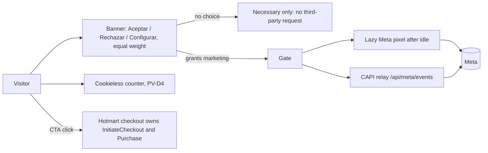

# Target state

Principle: pragmatic Clean Architecture. This is a small commercial site with no database, authentication or request-time logic. The dependency rule is mandatory and already guarded; extra layers only where a policy, a test seam or an ownership boundary exists (ecosystem section 9, O3). Nothing here adds a layer for ceremony.

## 1. Which build is production? (clarification requested by the owner)

Read from docs and build config on `origin/develop` `cbf519c`:

| Question | Answer | Evidence |
|---|---|---|
| What serves pequeverso.com today? | A **Hostinger Node.js Web App** connected to `main` since 2026-10-13; Hostinger runs `npm install` and `npm run build` on its builder (Node 24, GLIBC 2.28), forces `output: 'standalone'` and starts Next's server | `docs/deployment.md` "Current hosting status"; `docs/architecture.md` "Build targets" (status row); AGENTS.md "Workflow" |
| How does the code know? | `config/next.ts` picks `standalone` when `NEXT_OUTPUT=standalone` or when the build directory is under `/hbuilds/`; otherwise `export` | `config/next.ts`, `tools/lib/build-target.ts` |
| What is static export then? | The documented default (`NEXT_OUTPUT` unset) and the artifact CI builds and tests on every PR (`out/`, budgets, Lighthouse, Playwright all run on it). Nothing deploys it unless the Deploy workflow is run by hand (publishes `out/` to the `deploy` branch for a LiteSpeed website that is not in use) | `docs/reference/ci-profile.md`; `.github/workflows/deploy.yml` |
| Why do ADR-0001 and AGENTS.md say "static export"? | They predate the 2026-10-13 hosting switch; ADR-0001's addendum already admits the Node app mode and that `main` deploys every merge; the AGENTS.md header was not updated | `docs/decisions/ADR-0001-hosting-target.md` |
| What differs in production because of standalone? | Redirects and headers come from Next `redirects()` and `headers()` (not `.htaccess`); the CAPI relay route `src/app/api/meta/events/route.standalone.ts` exists (compiled only with `pageExtensions` containing `standalone.ts`); a Node process can idle-stop (cold start); no rollback UI (revert PR on `main`); `Cache-Control` for static assets is whatever Next or the Hostinger/Cloudflare layer applies (live 4 h on `/_next/static`) | `config/next.ts`; `docs/deployment.md` trade-offs; audit F-07 |
| What is the CI blind spot? | CI measures the export on a local server without third parties; production is standalone behind Cloudflare with the pixel. Docs numbers (100 / 699 ms) are from the export | `docs/performance.md`; `lighthouserc.json` |

Decision (D-01, PV-D3 resolved: DR-08): production target is standalone. Consequences:

1. **M1:** the parity job inverts: the primary CI build is `NEXT_OUTPUT=standalone` run with `npm start`; the export build is kept as a nightly parity job until M4.
2. **M3:** the production-config Lighthouse lane runs against the standalone server with a fake pixel id and the real third-party hosts allowed (so the pixel's cost is visible), plus a nightly lane against the live URL.
3. **M4:** retire the export path: delete `tools/serve-static.ts`, `tools/gen-htaccess.ts`, `docs/generated/htaccess.txt` (`docs/migration/old-domain.htaccess` is already deleted in M1-10; old domain digitalproductsteam.com is not renewed and not redirected, OD-53; its history stays in git), the `deploy` branch publishing in `deploy.yml`, and the `pageExtensions` trick (`route.standalone.ts` becomes `route.ts`). Update AGENTS.md, ADR-0010 supersedes ADR-0001.
4. Rules that disappear: "no route handlers beyond sitemap/robots", "no request-time APIs" stay as policy for static rendering (keep pages statically rendered by design: speed and Hostinger idle behaviour), but they are no longer imposed by the export.
5. Cold starts: add a keep-warm probe only if the production synthetic (daily plus nightly) shows TTFB above 800 ms; do not pay for it preemptively.

Node stays 24 (host) with CI matrix 24 only; a Node 26 job is added as non-blocking when Hostinger lists 26 (deviation D-11).

## 2. Target source tree

```text
config/              site, commerce, affiliates, products/, budgets.json, edge-rules.json, csp.generated.json (M5, optional)
content/es/          reviewed public copy (typed); legal/
contracts/           assistant-api/ and site-analytics/ snapshots with source.json (unchanged)
design/tokens/       pequeverso.tokens.json (DTCG 2025.10 source of truth)
src/app/             routes only: layout, pages, robots, sitemap, error, not-found, api/meta/events/route.ts (after M4)
src/views/           page composition; seo/ (metadata.ts, product-jsonld.ts, organization-jsonld.ts, website-jsonld.ts, json-ld.tsx safe serializer); product/, home/, legal/
src/shell/           page shell, header, footer, mobile nav, page motion
src/features/
  assistant/         unchanged (disabled)
  commerce/          checkout URL builder (domain), links, sticky CTA, Hotmart widget slot
  consent/           NEW: domain (policy, storage format, version), adapters (localStorage + cookie), presentation (banner, settings link); consumed by tracking, site-analytics
  tracking/          adapters (meta, meta-capi), server relay core; gated by consent
  site-analytics/    unchanged contract, consumes consent
  gallery/ hub/ landing/ playground/
  proof/             created when the first consented proof asset exists (no empty layer before)
  sample/            created with PV-D6 (sample-sheet download card)
src/shared/          ui (primitives), editorial (blocks), motion, identity, media, navigation, styles, tokens/ (generated theme.css)
tools/               build, check and CI scripts; tools/scorecard/ NEW; tools/media unchanged
tests/               unit, browser (+ perf/, + a11y/), assistant, helpers
ratchets/            committed baselines (guard, coverage, mutation, lighthouse, a11y, complexity, repo-size, design-lint, scorecard-axes)
docs/                Diátaxis: tutorials/ how-to/ reference/ explanation/ decisions/ architecture/ plus master-plan/
```

Why `features/consent`: consent is now used by three features (tracking, site-analytics, assistant gate) and carries a legal policy that must be one function. Today the policy lives in `tracking/adapters/consent.ts` and a second freshness rule in `site-analytics/domain/consent.ts`; two sources of truth for one legal rule is the duplication that justifies the module (O3 test: a real policy and a real seam).

Why no `ports/adapters` elsewhere: static content, no data client; ecosystem section 9 tells public sites to avoid use-case classes and DALs. The assistant keeps its existing domain/application/adapters/presentation layering because it has a real transport seam.

## 3. Guard rules (enforced by `npm run test:architecture`, negative fixtures required)

Existing rules stay (inward assistant dependencies, composition only in `entry.ts`, no runtime cycles, client/server isolation, registry never in client graph). Additions:

| Rule | Mechanism | Negative fixture |
|---|---|---|
| `process.env` only in `config/` and `tools/` (client-inlined `NEXT_PUBLIC_*` read in `config/`) | Biome `noRestrictedGlobals` plus architecture test | file in `src/features` reading `process.env` |
| Third-party script hosts only inside `features/tracking` adapters and `features/commerce/hotmart-widget-slot.tsx`, each behind consent or user intent | Architecture test greps `src` for `https://` script URLs and `next/script` use | `next/script` with an unlisted host in `src/views` |
| Nothing in `src/app`, `src/views` or `src/shell` imports `features/tracking/adapters/*` or `features/assistant/adapters/*` | Existing client graph test extended | view importing an adapter |
| `consent` has no dependency on `tracking` or `site-analytics` | Domain direction test | consent importing tracking |
| Coral token utilities only in `shared/ui/button*`, `commerce` presentation, price blocks | `tests/unit/design-lint.test.ts` scans `.tsx` classes | `text-coral` in a view |
| No colour, spacing or radius literals outside generated tokens and `globals.css` | Design lint (hex, `oklch(`, `rgb(` in `.tsx/.css`) | `#fff` in a component |
| No `transition: all`, no animation of properties other than transform, opacity (and documented exceptions) | Stylelint-class rule or unit test over `.css` and class strings | `transition: all` |
| `dangerouslySetInnerHTML` only in `src/views/seo/json-ld.tsx` (escaped) and the offer-mode script | Biome ignore list replaced by architecture test | JSON-LD without escape |
| Assistant: no trace in DOM or layout when disabled | `check-assistant-disabled`, `assistant-disabled.spec.ts` (existing) plus layout-shift visual case | n/a |

## 4. TypeScript and typing policy

Already at the standard (strict, `exactOptionalPropertyTypes`, `erasableSyntaxOnly`, `verbatimModuleSyntax`). Remaining items:

- `noPropertyAccessFromIndexSignature` and `noImplicitOverride` stay on; add `noUnusedLocals` and `noUnusedParameters` only if Biome does not already enforce them (Biome does: no change).
- TSDoc on exported symbols that are not obvious from their type (existing convention); check with a Biome or unit rule only for `config/` and `src/features/*/domain`.
- `type` for unions, `interface` for extendable shapes (CONTRIBUTING says `type` for props: keep, it is stricter than the standard and documented).
- File naming kebab-case (already).

### JavaScript destinations (every `.js/.mjs/.cjs`)

| File | Tracked? | Destination | Justification |
|---|---|---|---|
| `next.config.mjs` | yes (one line: `export { default } from "./config/next.ts";`) | **Keep as the single justified exception** | Hostinger's builder wraps exactly the name `next.config.mjs` and loads it without SWC on GLIBC 2.28 (ADR-0007); real configuration is `config/next.ts`; guarded by `tests/unit/build-target.test.ts`, which must also assert that the file contains nothing else |
| `src/shared/styles/cn-tables.js` | no (gitignored, generated by `cn/next` before every build) | **Stay generated and ignored** | Output of the class-merge compiler; its declaration `cn-tables.d.ts` is tracked; Biome and knip ignore it; a clean-checkout test (nightly) asserts the generated file is absent from git |
| Hosting `/hbuilds/` scripts or others | none | n/a | Node runs `.ts` by type stripping everywhere else |

## 5. Headers, cache and CSP target

| Item | Today | Target | When |
|---|---|---|---|
| HSTS | `max-age=300` | `max-age=31536000; includeSubDomains` after a verified week of valid HTTPS on apex and www; no `preload` | M3 (PV-D9) |
| CSP | report-only with `'unsafe-inline'` | Enforced: `default-src 'self'`, explicit script hosts (Hotmart only on routes that need it; Meta host only after consent injects it, which needs a nonce-free approach: allow `connect.facebook.net` while consent is the gate), `object-src 'none'`, `base-uri 'self'`, `frame-ancestors 'self'`, `form-action` limited | M3 enforced; M5 per-route script hashes if the spike (below) works |
| CSP spike | n/a | Build step extracts inline script hashes per exported route into `config/csp.generated.json`; Next `headers()` emits route-specific `script-src` hashes; failing that, the enforced policy keeps `'unsafe-inline'` for scripts as a compensating control and the axis stays at floor 90 | M5 |
| `/_next/static` cache | 4 h live | `public, max-age=31536000, immutable` verified with `curl -I` against origin and through Cloudflare; if Hostinger or Cloudflare overrides, add a Cloudflare cache rule (owner) | M3 (PV-D9) |
| Permissions-Policy | camera, microphone, geolocation, payment, browsing-topics off | keep as is (the header snapshot test locks it) | M2 |
| `security.txt` | missing | `/.well-known/security.txt` (RFC 9116) with contact and expiry; SECURITY.md contact fixed | M1 |
| Header snapshot test | none | `tests/unit/headers.test.ts` renders `edge-rules.json` to Next headers and compares to a snapshot; production-daily compares live headers | M2 |

## 6. Consent and measurement data flow (target)



Rules: nothing from the right-hand side loads before a stored grant; withdrawal revokes the vendor, expires `_fbp` and `_fbc` and drops the queue (already implemented); consent version bump re-prompts everyone (needed once at the policy switch).

## 7. ADRs to write (MADR 4, `docs/decisions/`)

| ADR | Title | Supersedes or amends | Milestone |
|---|---|---|---|
| ADR-0010 | Production target is the standalone Node app on Hostinger | Supersedes ADR-0001 | M1 (retire export at M4) |
| ADR-0011 | Prior opt-in consent for marketing measurement | Amends ADR-0003; replaces the owner opt-out decision of 2026-09-14 (PV-D1 resolved: opt-in, DR-01) | M3 |
| ADR-0012 | Design tokens in DTCG with a generated theme; dark-ready, light-only | Amends ADR-0006 with dark-mode evidence | M2 |
| ADR-0013 | Conversion page architecture and CTA rhythm | New | M5 |
| ADR-0014 | CSP enforcement strategy (hashes versus compensating `unsafe-inline`) | New | M3 / M5 |
| ADR-0015 | Test runner and mutation tooling (E7 outcome) | New | M2 |
| ADR-0016 | Consent feature module and analytics tiers | Amends ADR-0003, ADR-0009 | M4 |
| ADR-0017 | Phones receive the static starfield; WebGL scene on capable desktops only | Amends the motion section of ADR-0006 | M3 |

Existing ADRs get their "Confirmation" section and stable paths; ADR-0004 (CI topology) and ADR-0009 (spine) are amended with a header note instead of rewritten.

## 8. Migration order

1. M1: old-domain docs sweep (M1-10), CI profiles, `ci-gate`, Dependabot single group, standards adoption, community files.
2. M3 (early in M3, on `develop`; no hotfix, DR-01): consent opt-in + lazy gated pixel (+ banner copy); all of it reaches production at M7.
3. M2: test net and scorecard tooling before the visible redesign, so the redesign is measured.
4. M3: performance (scene on desktop only, pixel fixed, JS budget cuts), axe fix, headers, cache, sitemap and JSON-LD hygiene, README and ADR refresh.
5. M4: `features/consent` extraction, standalone-only, tokens in DTCG, docs reorganized (Diátaxis), complexity ratchet.
6. M5: design playbook implementation (page, tokens, components, motion, states) and the content cluster.
7. M6: re-score, close gaps. M7: coordinated release; verify `build-info.json` against the merge SHA.
