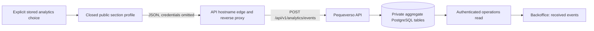

# Optional site analytics — disabled by default

This channel prepares aggregate product navigation evidence for the private backoffice. It is
independent of the shopping assistant, Meta Pixel and CAPI. It never proves visitors, purchases,
revenue, conversion attribution, or that a section was read. No production collection is authorized.

## Build and activation contract

`NEXT_PUBLIC_PRODUCT_ANALYTICS_ENABLED=false` is the default. An enabled build requires a bare
HTTPS `NEXT_PUBLIC_PRODUCT_ANALYTICS_API_ORIGIN`. The browser calls that origin directly; both
static export and standalone remain supported. There is no site relay, new credential, or dependency.
The exact origin is added to the existing CSP report-only connect policy on both targets only when
configured. This does not convert the existing report-only policy into enforcement.

The disabled branch does not import the collection runtime. `build-info.json` records `site_analytics: "disabled"`; `npm run check:site-analytics-disabled` scans emitted artifacts and is required in publication CI. Activation needs separate owner approval,
an enabled API, explicit CORS origins, HTTPS and a tested ingress/rate-limit policy. Preparing or
merging this implementation does not authorize enabling either analytics or the assistant.
`PRODUCT_ANALYTICS_LOCAL_TEST_BUILD=true` permits loopback HTTP(S) only for isolated fixtures.
Never use this exception in a publishable build. Missing configuration fails closed without echoing it.

## Consent and minimisation

Collection requires a stored current-version analytics grant with a valid canonical timestamp less than 180 days old. A missing, invalid or expired stored choice
never inherits the existing Meta opt-out default. Existing Meta/CAPI events, consent schema/version,
checkout and attribution remain unchanged. The optional tool is listed in the existing banner;
accept/reject/save continue to use the existing storage and footer preference controls.

The closed schema1 snapshot in `contracts/site-analytics/` comes byte-for-byte from API commit
`a005e992a54f87c7ec8e6f188666e98be0c05912`. Its SHA256 is
`10264058e6c9b26fd308f51eaa2b9286b352b418e2c625511caf22d0e9c7dcf7`.
Allowed routes are `/` and `/grafismo-fonetico/`; the affiliate route redirects and is not measured.
Only approved section IDs, ES locale, coarse viewport bucket and layout revision are sent, with an
independent event UUID for deduplication. No session/visitor ID, query, fragment, referrer, free text,
HTML, form values, conversation, raw pointer coordinates or client country is transmitted.

A section-view means its heading was at least half visible continuously for 500 ms while the document
was visible. It is not proof of reading. Only native trusted primary-button pointer clicks with
nonzero detail qualify; keyboard activation and synthetic events are not counted as pointer heatmap
clicks. Forms, dialogs, editable/private regions and custom elements are excluded. Cells use an 8×8
section-relative grid. Navigation and every dispatch recheck consent; an immediate in-memory withdrawal remains effective even if storage persistence fails. A subsequent fresh persisted acceptance can restore collection. This safeguard applies to the current document; if all persistence is unavailable a future fresh document cannot remember the failed write. Navigation rechecks consent before dispatch; revocation, hiding, pagehide and
unmount abort pending requests and dispose observers. A restored document does not replay its page view.

Limits are four concurrent requests, five seconds each, 40 admitted events/minute and 120/document.
Failures and admission drops are silent, never queued or retried. No unload beacon or persistent queue.
Blocking analytics must never block navigation or a purchase.

## Backend and operations handoff

The API persists synthetic versus production classification in separate aggregate namespaces without
resetting global deduplication or quotas. Backoffice reads require its existing operations permission
and server-only token. Default country is unknown; optional trusted-proxy country attribution requires
Ops to prove origin bypass protection, header overwrite and the actual socket peer. Configuration or
an owner's CDN setting does not prove that chain. Small buckets are withheld; retention is 93 days.
No browser country, IP-derived identifier or purchase event is accepted.

Canonical cross-project reference: Portfolio API commit
`13d9ed041e9bbfbe1e9d519a82235d0e75e603d7:docs/coordination/analytics-direct-edge-v1.md`.
The Pequeverso profile, Spanish identity and existing consent policy remain product-owned.

## Verification

`node --test tests/unit/site-analytics/collection.test.ts` covers explicit consent, route/section
bounds, payload minimisation, quotas, revocation, request bounds, safe environment parsing and both
header targets. `tests/browser/site-analytics-dom.spec.ts` tests the actual DOM adapter with native
browser input; this is an isolated DOM fixture, not API, production traffic or edge verification.
Full website builds and published disabled artifacts require their normal repository checks.
