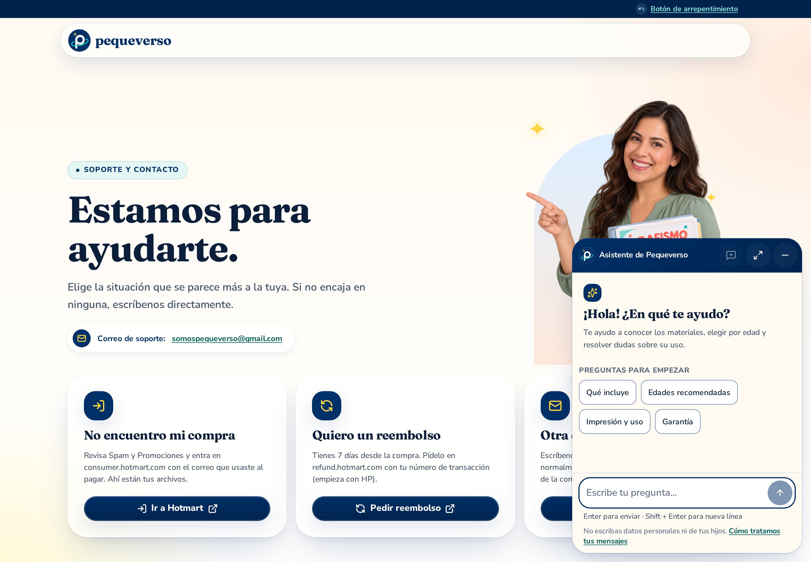
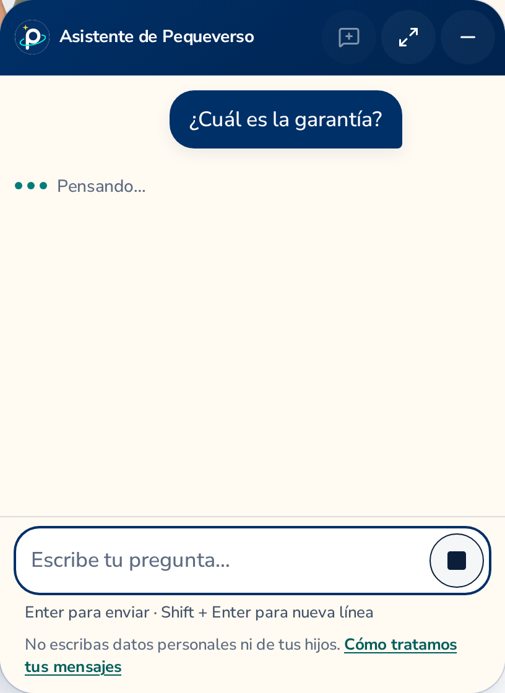
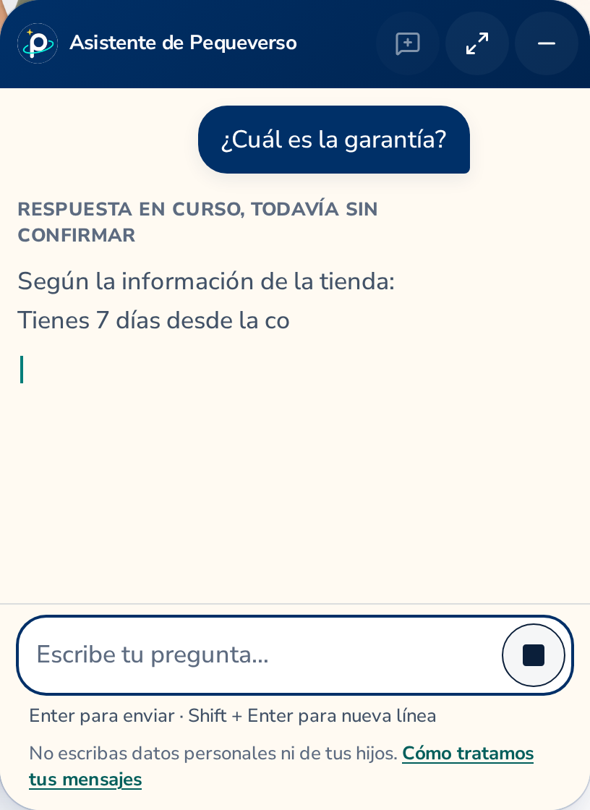
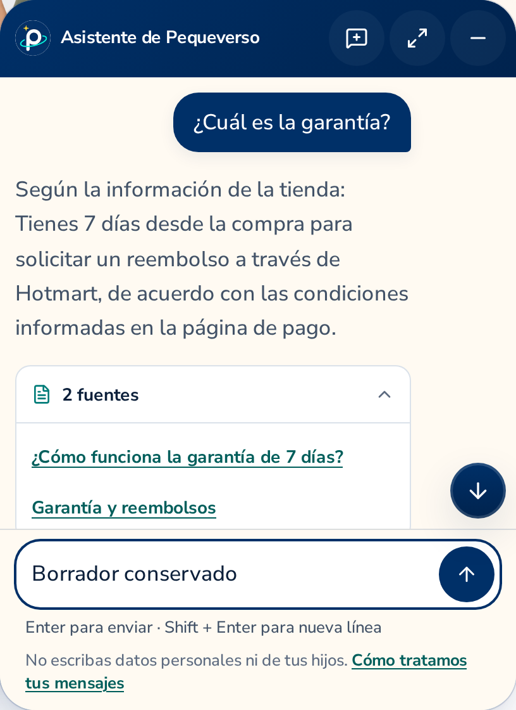
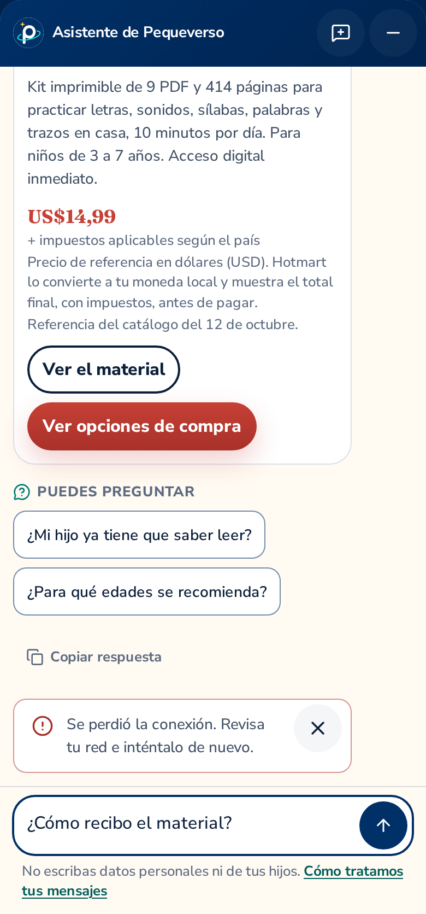

# Native assistant — reviewed local photography, 2026-10-12

These PNGs photograph the actual rendered interface at **DPR 2**. Desktop uses a
**1440 × 1000 CSS px** viewport and the real **408 × 560 CSS px default compact panel**;
mobile uses **390 × 844 CSS px**. Full-window photographs preserve the surrounding store.
Panel details are element screenshots, not enlarged layouts, generated mockups or collages.

**Provider: fixture. Production: disabled.** The enabled export is an unpublished local
verification artifact. The fixture API exercises sessions, cookies, CSRF and HTTP/SSE over
throwaway self-signed HTTPS loopback. These photographs do not validate the model or the VPS.

Build: `8865edd5ff9fe471f1eb335a195a33cbc8662898`; presentation runtime:
`ec32eb1a3bbcd11eae49f20dfb6da670ddce4b5d`; reviewed backend source commit:
`b7dcb0c27d214cb1b560a8ee6101f858545646fc` (public contract v1, revision 1.4).
The [manifest](manifest.json) records dimensions, file hashes, configuration and capture receipts.
The implementing agent and an independent agent inspected all 14 selected PNGs at original detail
and approved their legibility, alignment and composition. This is agent review, not human review.

## The panel in the store

The star-only launcher opens on an explicit action. The compact panel leaves the page usable,
with no backdrop; the mobile surface uses the available viewport.

[](02-Desktop-Bienvenida.png)

| Launcher | Completed answer and sources | Waiting with a Stop control |
|---|---|---|
| [Full desktop photograph](01-Desktop-Boton.png) | [Full desktop photograph](03-Desktop-Conversacion.png) | [Full desktop photograph](04-Desktop-Espera.png) |
| [Mobile welcome](05-Mobile-Bienvenida.png) | [Mobile answer, sources and input](06-Mobile-Conversacion.png) | Each file opens at its full original resolution. |

## Welcome and a grounded answer

The interface has the exact title **Asistente de Pequeverso**, four readable opening chips and
no language selector. It keeps physical 44 px controls, while the typography and icon sizes
remain light. The answer is followed immediately by its validated source disclosure.

| Welcome, four opening questions and composer | Final answer and expanded sources |
|---|---|
| <a href="desktop-bienvenida-detalle.png"></a> | <a href="desktop-respuesta-fuentes-detalle.png"></a> |

## Waiting and streaming

Waiting photographs hold the actual message HTTP request before continuing it. The streaming
photograph captures real fixture SSE chunks and the truthful, still-unconfirmed answer label.
Neither view invents percentages, searches, tools or provider stages.

| HTTP request pending | SSE answer still in progress |
|---|---|
| <a href="desktop-espera-detalle.png"></a> | <a href="desktop-streaming-detalle.png"></a> |

## Product details and continuity

This mobile photograph shows the entire product card, including its full summary, age, catalog
price, taxes/currency explanation, catalog-reference date and both permitted product-page actions.
The following questions and composer are visible too. This is a genuine scroll position in the
conversation, not stitched content. Prices are a **dated catalog snapshot**, not a purchase quote.

The restored desktop view preserves the conversation and a draft after minimizing. This state
uses the same mounted runtime; it is not presented as proof of a backend reload or VPS persistence.

| Full product card, follow-up chips and input | Restored conversation and retained draft |
|---|---|
| <a href="mobile-producto-precio-acciones-detalle.png"></a> | <a href="desktop-conversacion-restaurada-detalle.png"></a> |

## A recoverable network error

The error photographs interrupt the transport of a newly submitted question. The draft remains
visible and the visitor gets a safe, local explanation. No generation is repeated automatically.

| Desktop | Mobile |
|---|---|
| <a href="desktop-error-conexion-detalle.png"></a> | <a href="mobile-error-conexion-detalle.png"></a> |

## Verification boundaries

The local source check passed 160 unit tests, a 14-page disabled export, absence guard over
127 text files and the project budgets. The two previously failing Firefox cases passed an
isolated revalidation without changing their 45 s deadline, assertions or retries. The original
60-case affected run remains **51 passed, 7 skipped, 2 failed, 0 flaky**; its result is preserved.
Public playground verification passed 16 cases; text at 200 % passed both changed routes across
Chromium, Firefox and WebKit at 320/390 px (6 cases, 4 configuration skips).

These photographs and checks do not establish physical keyboard behavior, field performance,
production HTTPS/CORS/cookies/proxy behavior, actual Hotmart purchases or commercial correctness
of model answers. See the [verification record](../../assistant.md) and
[activation checklist](../../../assistant.md).

## Reproduce the photography

Use the isolated API checkout at `tests/assistant/api-revision` with `uv sync --frozen`.
The photography config inherits the fixture-only API environment, CORS, CSRF, temporary database
and HTTPS loopback from the normal assistant config. It is outside the normal CI test directory;
its 90 s case covers eight successive photo states and does not change the 45 s behavioral gates.

```bash
npm run build:assistant-fixture
ASSISTANT_API_DIR=/path/to/isolated-api-checkout \
  npx playwright test -c docs/verification/assistant/2026-10-12/capture.config.ts
```

Output: `test-results-assistant/gallery/`; optionally set `ASSISTANT_GALLERY_DIR` to a separate
local evidence directory. Neither command enables a publishable build or contacts a model.
Review the generated images before copying them into documentation or the Desktop preview.
