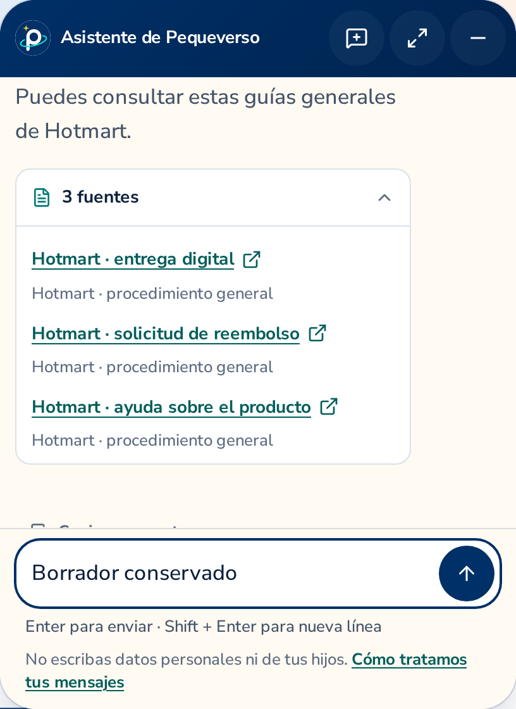
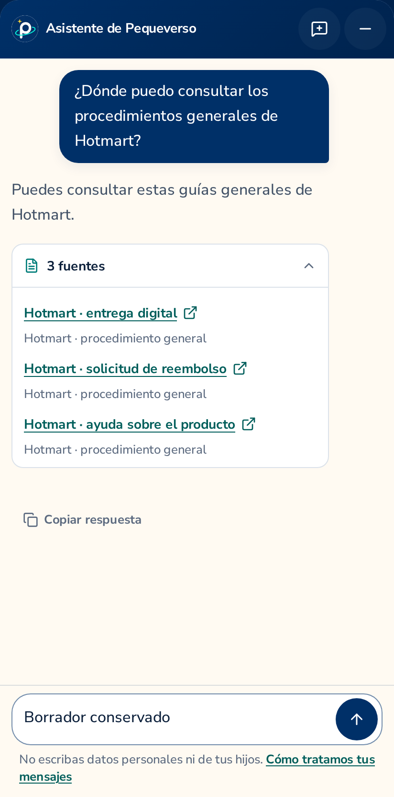

# Exact informational Hotmart source links

These local DPR-2 photographs show the native Pequeverso assistant with three exact official
article URLs and the scope label “Hotmart · procedimiento general”. They use synthetic citation
fields over a real isolated fixture session/CSRF/HTTP/SSE flow. They do not show live article
retrieval, model answers, source freshness or backend persistence of the enriched fields.
The publishable assistant remains disabled; no provider key, paid call or deployment is involved.

The desktop transcript is naturally scrolled to the complete answer and citations. The earlier
question is above the viewport and the copy action is partly below it; content is still reachable
by scrolling. No panel expansion, hidden CSS, image manipulation or product change was used.

The three titles come from the response; the additional scope label is controlled by the exact
consumer URL policy. Opening these references is always a visitor action, never an automatic
request. Unknown paths, redirect/query parameters, fragments and noncanonical URL variants are
rejected without granting the entire help host. Existing catalog-source identities stay intact.

## Verification and preserved failures

- Final full check: 187.123 seconds, 172 unit tests and disabled guard over 127 text files.
- Skills check: 2.384 seconds.
- Initial twelve fixture cases: six malicious-citation cases passed; six positive cases failed
  because the test's exact accessible name omitted the existing new-tab announcement. All twelve
  had retry zero. The failure reports and traces remain private and intact.
- A later test-only type error in the literal host-tuple assertion failed before browsers ran;
  strict typing was preserved by asserting the complete unchanged tuple.
- Positive revalidation: all six browser projects passed at unchanged 45-second limits and retry
  zero (159.830 seconds test-report duration; 163.545 seconds process duration).
- Desktop photography recapture used a separate private 90-second recipe; it is not a functional
  gate. Its first startup failed due to a relative server working directory and executed no case.
  The corrected actual-scroll capture passed once in 42.9 seconds, without retries.

The runtime used for these photographs predates only test corrections; application/config/copy
bytes remain identical. The exact revisions and image digests are recorded in `manifest.json`.
The coordinating Root agent independently reviewed the source and both original PNGs; no human
review is claimed. Exact-head CI remains pending. Real controlled
web retrieval, provider accounting and commercial-answer correctness belong to the backend
handoff. VPS/production behavior and physical keyboards remain unverified here.
